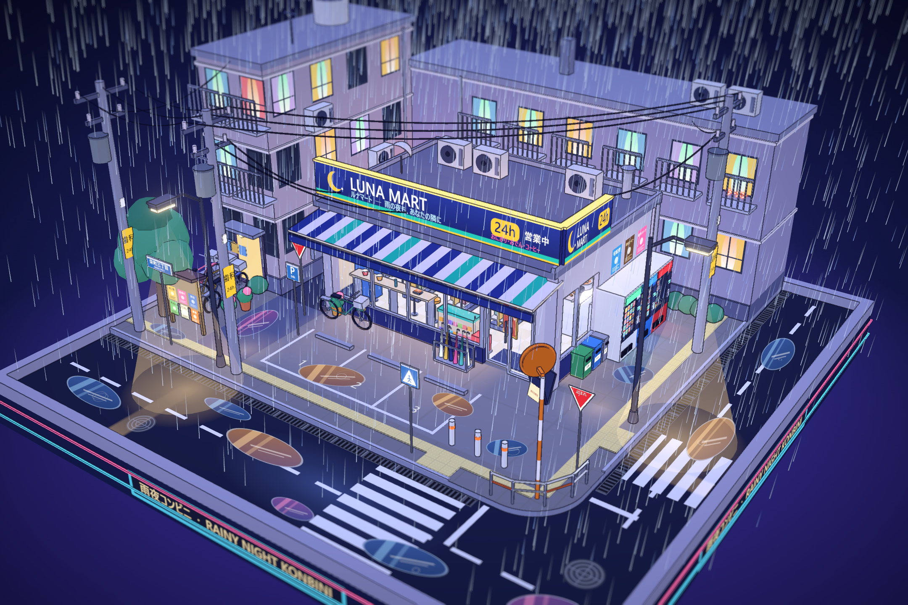
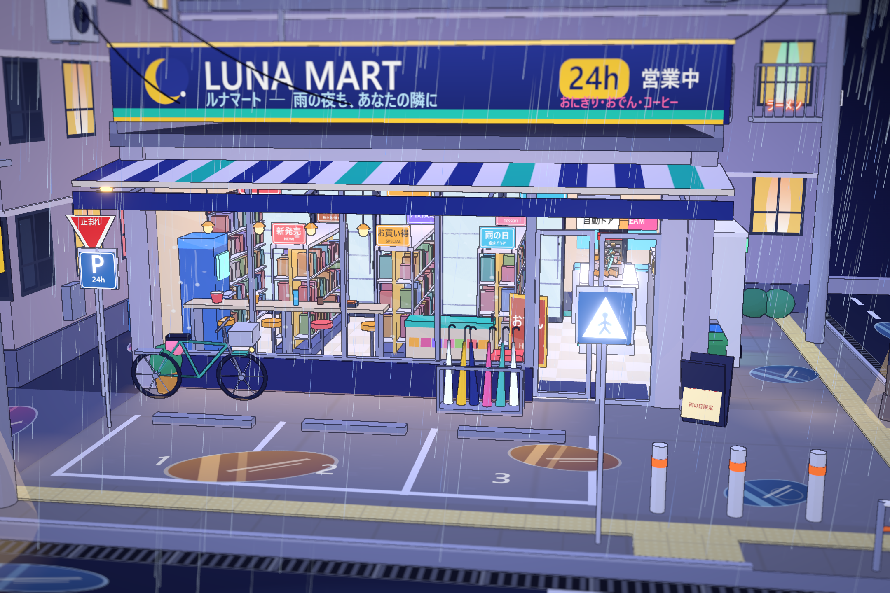
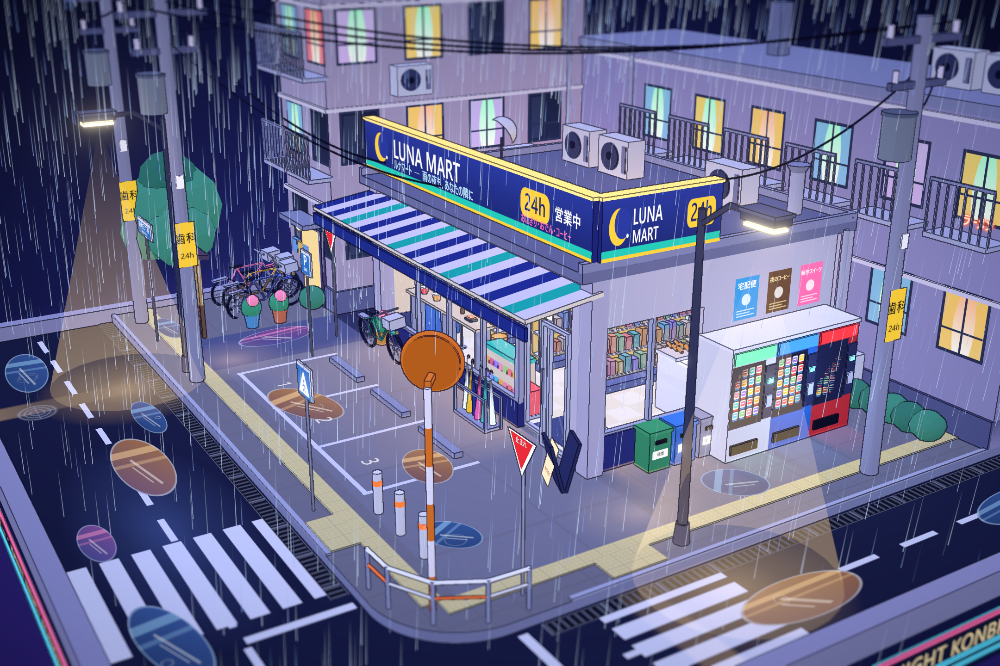
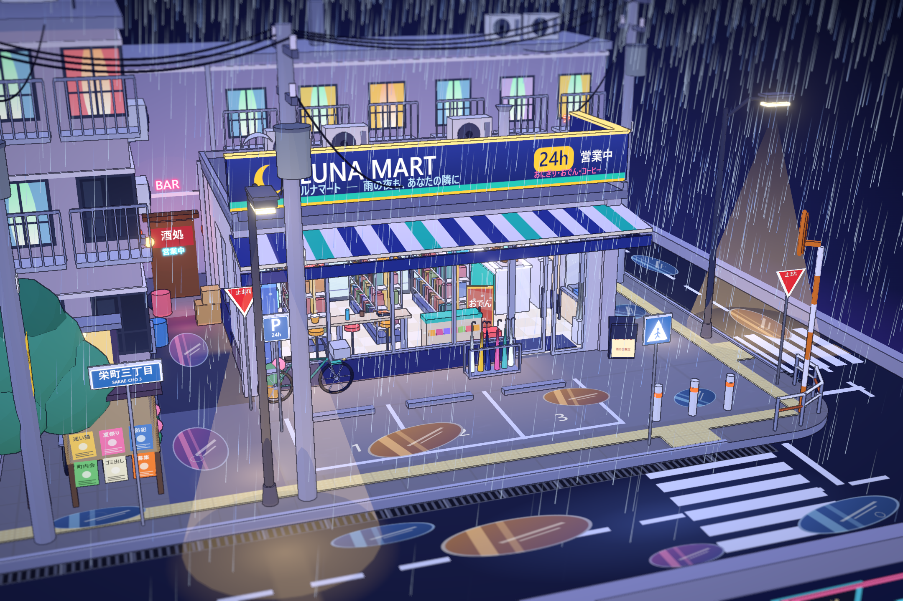
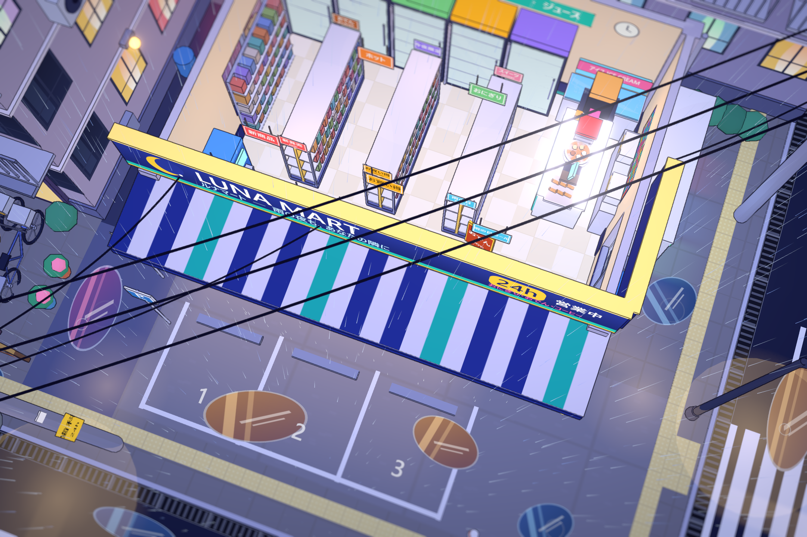
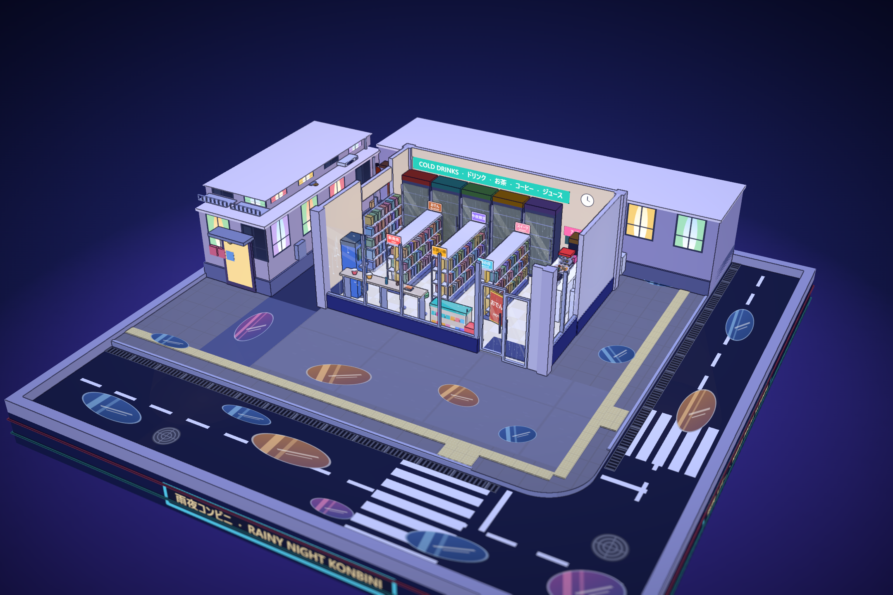

# 雨夜便利店街角 · 三渲二微缩三维场景 (Rainy Night Konbini Diorama)

👉 **在线直接体验（无需安装，点击即玩）：[https://shiwoxiaobailong0828-maker.github.io/rainy-night-konbini-diorama/](https://shiwoxiaobailong0828-maker.github.io/rainy-night-konbini-diorama/)**

一个基于 **Three.js** 构建的日式二次元动画风格（三渲二 / Cel-Shading）微缩三维街角景观模型。
全场景搭建在 `16m × 16m` 的可收藏展示底座上，无任何 UI 界面遮挡，支持自由拖拽、旋转、缩放观察，内置**从下往上零穿模逐层拼装入场动画**、**纯 Web Audio API 程序化环境音效**以及**多模式动态天气系统**。

---

## 场景效果预览

| 全景微缩街角视角 | 便利店暖光室内陈设特写 |
| :---: | :---: |
|  |  |

| 街角自动贩卖机与斑马线 | 居酒屋后巷与霓虹灯牌 |
| :---: | :---: |
|  |  |

| 俯视自动剖切屋顶（娃娃屋视角） | 从下往上逐层拼装动画过程 |
| :---: | :---: |
|  |  |

---

## 核心特性

1. **三渲二（Cel-Shading）日式动画渲染管线**
   - 4 阶离散色阶 Toon 材质（`MeshToonMaterial` + 自定义 `DataTexture` 渐变贴图）
   - 基于法线与深度缓冲的屏幕空间全场景漫画描边（Screen-Space Cel Outline）
   - 精准控制阈值的霓虹辉光（`UnrealBloomPass`）与微缩模型移轴景深（Tilt-Shift Blur）

2. **从下往上、零穿模的 6 阶段模块化搭建动画**
   - 摒弃杂乱的空中掉落，所有部件严格基于自身世界包围盒底部锚点 `(center.x, min.y, center.z)` 原地向上生长，杜绝位移穿模与旋转穿插：
     1. **展示底座**：胡桃木收藏级底座、金色铭牌与双色环绕灯带
     2. **地面与路网**：柏油路、导盲砖人行道、反光斑马线、积水涟漪与排水沟
     3. **店内陈设（先行搭建）**：在墙体封闭前先铺设黑白棋盘格地面与全部货架/收银台，一览无余
     4. **建筑逐层拔起**：便利店玻璃幕墙 + 邻栋公寓严格按 `1F → 2F → 3F → 屋顶` 逐层向上生长
     5. **招牌与屋顶设备**：L 型三色发光雨棚、楼顶巨型 `LUNA MART 24h` 灯箱、天台水箱与空调外机
     6. **街角道具依次落位**：电线杆、悬链线电缆、路灯、自动贩卖机、自行车、护栏与植被

3. **丰富温暖的便利店内部细节（透过大面积橱窗清晰可见）**
   - 5 门冷饮冰柜、冰淇淋卧柜、3 排双面中岛货架、靠墙杯面零食架、双层杂志漫画架
   - L 型收银台：双 POS 收银机、金黄炸物保温柜、关东煮九宫格汤锅、中华包蒸笼、咖啡机、香烟架、微波炉
   - 靠窗吧台区：4 把高脚凳、热腾腾的豚骨拉面碗、便当盒、绿茶杯与筷子筒
   - 俯视视角（相机仰角较高时）自动平滑半透明剖切便利店屋顶，方便直接俯瞰店内全貌

4. **纯 Web Audio API 程序化音效 + 4 档动态天气系统**
   - 无需任何外部音频文件，纯代码实时合成：积木搭建清脆哒哒声、便利店通电嗡鸣、经典日式便利店门铃（ファミリーマート风旋律）、立体声风声雨声、远近雷鸣
   - 支持 **微雨 / 中雨 / 雷暴 / 晴朗星夜** 4 种天气模式实时切换，包含 3D 分叉闪电、屋檐滴水、地面涟漪与体积雾

---

## 交互与快捷键说明

| 操作 / 按键 | 功能说明 |
| :--- | :--- |
| **鼠标左键拖拽** | 360° 围绕场景自由旋转观察 |
| **鼠标右键拖拽** | 平移视角焦点 |
| **鼠标滚轮** | 缩放镜头（拉近可透过玻璃看清店内商品，拉高可触发屋顶半透明剖切） |
| **首次点击 / 按键** | 自动激活 Web Audio API 环境雨声与音效 |
| **`R` 键 / 双击画面** | 重新播放从下往上的完整组装入场动画（含搭建音效与通电门铃） |
| **`W` 键** | 循环切换天气模式（中雨 → 雷暴 → 晴朗星夜 → 微雨） |
| **`1` / `2` / `3` / `4` 键** | 直接切换至：`1` 微雨 / `2` 中雨 / `3` 雷暴 / `4` 晴朗星夜 |
| **`L` 键** | 立即手动触发一道 3D 闪电与雷鸣音效 |
| **`M` 键** | 静音 / 恢复全部音效 |

---

## 本地运行与构建

```bash
# 1. 安装依赖
npm install

# 2. 启动开发服务器
npm run dev

# 3. 打包生产版本
npm run build
```
